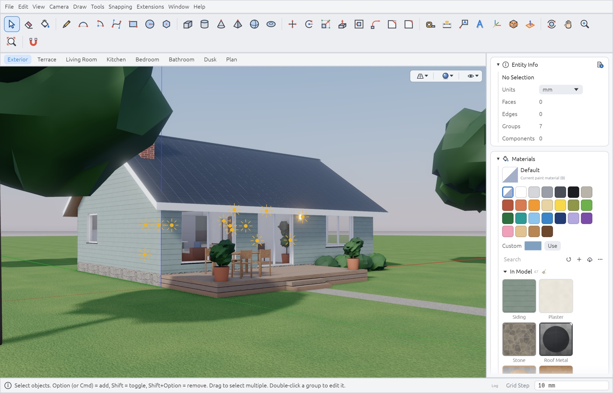
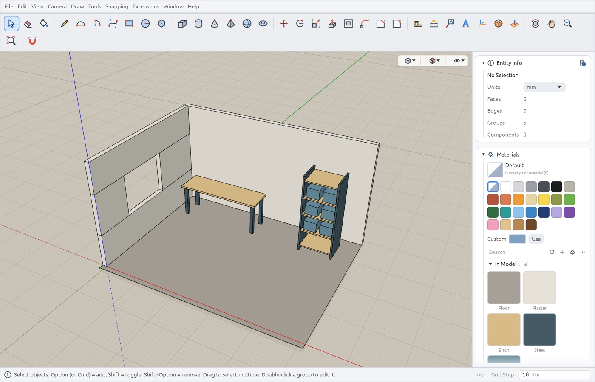

# Varstotas

A lightweight native 3D modeller in the classic push/pull style, for macOS, Windows and Linux.
Written in Rust (egui + wgpu). Models are in real units, and everything can be scripted.



## Features

- **Direct modelling** — lines, arcs, Bézier and freehand curves, Push/Pull, Offset, Follow Me,
  chamfer and fillet, with inference snapping (endpoints, midpoints, axes, parallel /
  perpendicular) and typed exact values.
- **Organising** — groups and reusable components, tags, outliner, scenes, section planes,
  dimensions and text, locks, several viewports.
- **Materials and rendering** — PBR materials with texture maps and a UV editor; a realistic
  real-time style with shadows, AO, reflections and bloom; a progressive GPU path tracer with
  denoising; custom WGSL shaders; animation export through scenes.
- **Libraries** — materials and components trays, online models and materials (Poly Haven,
  Smithsonian, NASA and more), parametric generators (shelves, stairs, railings…).
- **Scripting and automation** — Rhai console and scripts, plugins that add menu commands and
  importers, a Python client over a local bridge and an MCP server for AI agents.
- **Making things** — preparing models for a slicer (checks and repair, wall-thickness maps,
  cutting with dowels, bed layout, STL / 3MF export); unfolding to SVG / PDF / DXF; sheets with scaled views;
  simple physics (drop objects, drape cloth).
- **Formats** — import glTF / GLB, OBJ, STL, PLY, FBX, DAE, 3MF, DXF; export glTF / GLB, OBJ,
  STL, PLY, DAE, 3MF, PNG.
- **Languages** — English, Russian, Lithuanian, Belarusian (Preferences → Interface → Language).

<p>
  
  
</p>

## Download

Builds for macOS (`.dmg`), Windows (installer or portable `.zip`) and Linux (AppImage or
`.tar.gz`) are on the [Releases](https://github.com/dirondin/varstotas/releases) page.

## Building from source

```bash
cargo run --release -p varstotas_app     # run
cargo test --workspace                   # tests
tests/ui/run_all.sh [name …]             # UI regression scripts (macOS; explicit repository fixtures)
```

## Documents
- [Vision and UX principles](docs/00-VISION.md)
- [Features → plan and statuses](docs/01-FEATURES.md)
- [Architecture](docs/02-ARCHITECTURE.md)
- [Code map](docs/CODEMAP.md)
- [Roadmap](docs/03-ROADMAP.md)
- [UX specification of the tools](docs/05-UX-SPEC.md)
- [Scripting (Rhai, Python, bridge)](docs/SCRIPTING.md) · [Generators](docs/GENERATORS.md) · [Plugins](docs/PLUGINS.md) · [Shaders](docs/SHADERS.md)
- [Localization](docs/LOCALIZATION.md)
- [Security model](SECURITY.md)
- [Native document format and metadata](docs/FILE-FORMAT.md)

## Structure
```
crates/varstotas_kernel  — geometry kernel (sticky geometry, push/pull, offset, follow me, IO)
crates/varstotas_render  — wgpu renderer, camera, path tracer
crates/varstotas_script  — Rhai scripting API over the kernel
crates/varstotas_i18n    — localization (Fluent)
crates/varstotas_app     — application: UI, tools, inference, VCB, plugins
locales/                 — UI texts, one .ftl file per language
python/                  — Python client of the local bridge and the MCP server
examples/                — example plugins, scripts, generators and the demo models (.vrst)
tests/ui/                — UI regression scripts, fixtures, models
vendor/                  — egui_code_editor with a local fix
```

## Examples
The [examples catalogue](examples/README.md) lists eight ready-to-open models, including furniture,
a pergola, a staircase and a workshop, with editable construction scripts for six of them.
Demo scenes, scripts, plugins and optional generators live only in `examples/` in this repository.
They are not embedded in the application or installed into `~/.varstotas`.
**Help → Examples** opens the repository examples in a browser. Download what you need:
open `.vrst` demos with File → Open, run scripts with File → Run Script, copy selected plugins
to `~/.varstotas/plugins/`, and generators to your components library.
Previously installed files are left untouched. Built-in Draw → Shapes tools use their own
resources in `crates/varstotas_app/assets/primitives/`.

## Document templates
File → New from Template lists the built-in unit presets and `.vrst` files from
`~/.varstotas/templates/`. Open Templates Folder opens that directory in Finder / Explorer.
Preferences → General → Templates folder lets you choose another directory or restore the default.
A file template creates an untitled, unsaved copy with its model settings; Save prompts for a new
file and never overwrites the template automatically. Files added to the directory appear the next
time the menu is opened. Existing unsaved work is protected by the usual Save / Don't Save / Cancel prompt.

## 3D printing preparation

**Extensions → 3D printing preparation** opens one window with surface checks and conservative repair, intersection detection,
sampled wall-thickness heatmaps, overhang highlights, a persistent printer profile and bed
placement. Parts can be cut and capped, divided to fit a printer, and given sockets with
separate registration dowels. Scoped STL/3MF export preserves millimetres and separate 3MF
objects, with an optional handoff to a configured slicer. Mutations are undoable and retain
original scale. See [printing tools and limitations](docs/3D-PRINTING.md).

## Mesh inspection and imported assets

View → Triangles is an independent checkbox available over every display style, including
X-Ray. It shows the actual tessellation, polygon diagonals and soft edges. Each viewport and
saved scene keeps its own choice. Ordinary X-Ray suppresses internal shallow/coplanar edges
while keeping boundaries and strong creases.

Mesh import shares surface construction across glTF/GLB, OBJ, STL, PLY, FBX, DAE, 3MF and
DXF faces, preserving thin layers and overlapping polygons. Authored normals are retained
where the format supplies them; textured imports retain atlas UV shear. Legacy Blender
Lambert/Blinn sets incorrectly exported entirely as index-matched glass receive narrowly
scoped material recovery. Transform and paste previews show the complete selected mesh;
only library thumbnails use sampled edges. Previously imported
native assets need reimporting from their original files to recover information discarded
by older builds. Texture Position and Reverse Faces preserve the full affine placement.

## Tutorial and navigation

**Tutorial** is available on the start screen and in Help. Its ten-step wizard combines a
small modelling project, concrete exercises, tool activation buttons and links to detailed
help. It can stay open beside the model; Back/Next/Start over control the walkthrough.

Preferences → Navigation separates mouse-wheel settings from smooth two-finger swipes,
pinch zoom and two-finger twist. Configure sensitivity, inversion, orbit/pan/zoom for swipes,
and orbit around vertical / roll / off for twist. Native gesture availability depends on the
OS/driver. Smooth-scroll pointing devices use the same swipe settings.

Online model/material catalogues, asset downloads and previews show received bytes and a
percentage/total when Content-Length is available. Unknown totals show bytes received. Rhai
network helpers participate automatically; downloads inside external Python plugins and a
browser cannot provide byte progress unless they report it to the app.

## Document metadata

Window → Model Info is resizable, with Info (statistics), Meta (text, license and preview)
and Cleanup (unused resources) tabs. Meta offers multiline text/description and license fields
(name, URL or full text). Apply makes one undoable change; save the document to persist it. Native documents now
write format version 4 (authored corner normals and full affine UV placement) and continue
reading versions 1–3 with defaults for missing fields. Unsupported
versions are rejected. Material files retain their independent version 1.
See [format and compatibility](docs/FILE-FORMAT.md).

## Startup, feedback and previous saves

The start screen offers a new model with a unit preset, Open, recent documents, Examples and a
quick guide. **Show at startup** is shared with Preferences → Interface; File → Start Screen
opens it at any time. Opening a document from the command line skips the start screen:

```sh
target/debug/varstotas "/path/to/my model.vrst"
target/debug/varstotas --open "/path/to/my model.vrst"
open -n target/Varstotas.app --args "/path/to/my model.vrst"  # macOS bundle
```

`--help` and `--version` work without initializing the graphical application. File associations
are not registered yet.

**Help → Report a Problem** previews the message with version, platform and GPU details.
The latest warnings/errors are optional. Copy the report or open a prefilled GitHub issue in
your browser; sign in and submit it yourself. Private repositories require access. The app
stores no GitHub token and does not attach the model or screenshots automatically.

Explicit document saves, including bridge saves, keep one previous version beside the document:
`model.vrst` → `model.bak.vrst`. **Preferences → General → Keep a backup of the previous saved version**
is enabled by default; disabling it leaves existing backups untouched. Open the backup with File → Open to recover it, then Save As
to the desired filename. Saving an unchanged model preserves the last distinct backup.
If the backup cannot be written, the existing document is left intact
and saving reports an error. Autosave/recovery remains separate and does not rotate this backup.

## Release builds
Artifacts go to `dist/` (not tracked by git).

```bash
scripts/build-macos.sh      # macOS universal (arm64 + x86_64): .dmg + .zip
scripts/build-macos.sh --debug  # local target/Varstotas.app (correct Dock name and icon)
scripts/build-windows.sh    # Windows x86_64 portable .zip, cross-built from macOS
scripts/build-windows.sh --native  # on Windows (MSVC, Git Bash): .zip + installer
scripts/build-linux.sh      # Linux (this machine's arch): .tar.gz + .AppImage
```

- **macOS** — `scripts/build-macos.sh [--no-dmg]`: installs the `x86_64-apple-darwin` target if needed, builds release for both architectures, joins them with `lipo`, assembles `dist/Varstotas.app` (Info.plist: `dev.varstotas.app`, macOS ≥ 11, Retina), builds the icon (`crates/varstotas_app/assets/icon.png`, drawn by `scripts/make_icon.py` → `iconutil` → `.icns`), signs ad-hoc (`codesign -s -`) and packs `Varstotas-<version>-macos-universal.zip` and `.dmg` (with an Applications link). There is no Developer ID signature or notarization — on first launch: right click → "Open".
- **Windows** — `varstotas.exe` is a GUI-subsystem binary with the icon and version resource embedded (`crates/varstotas_app/build.rs`, `winresource`); Windows 10+, no external DLLs. `Varstotas-<version>-windows-x86_64.zip` is the portable build. With `--native` (MSVC on Windows) the script also builds `Varstotas-<version>-windows-x86_64-setup.exe` with Inno Setup 6 (`packaging/windows/varstotas.iss`; installed with Chocolatey when missing): per-user or all-users install, Start menu entry, optional desktop icon, the `.vrst` file association, uninstaller; English and Russian wizard. Without `--native` it cross-compiles with mingw-w64 (installed via brew) and makes the zip only.
- **Linux** — `scripts/build-linux.sh [--no-appimage]`: needs `pkg-config`, `libwayland-dev` and `libxkbcommon-dev`. `Varstotas-<version>-linux-<arch>.tar.gz` holds the binary, icons, `varstotas.desktop`, the `.vrst` file type (`packaging/linux`) and `install.sh` (into `~/.local`, `--uninstall`; `PREFIX=/usr/local` for everyone). `Varstotas-<version>-linux-<arch>.AppImage` is one runnable file, made with `appimagetool` (downloaded into `target/tools`). X11 and Wayland both work (loaded at run time); release builds are made on Ubuntu 22.04 (glibc 2.35).
- `VARSTOTAS_VERSION` overrides the version from Cargo in every script.
- Checking the build without a UI click: `VARSTOTAS_SCREENSHOT=shot.bmp dist/Varstotas.app/Contents/MacOS/varstotas` — captures the window and exits.

## CI and releases
GitHub Actions in `.github/workflows`:

- **CI** (`ci.yml`) — every pull request and push to `master`: `cargo clippy -D warnings` and `cargo test --workspace` on Linux.
- **Release** (`release.yml`) — pushing a tag `release-<version>`: unit tests and release builds on macOS, Windows and Linux, then a GitHub release of the tag titled "Varstotas <version>" with all the packages above and `SHA256SUMS.txt`. Its notes are a downloads table (`.github/release-notes.md`) followed by the changes since the previous release. A version with a `-` (`release-0.3.0-rc1`) makes a pre-release. Running the workflow by hand (Actions → Release → Run workflow) with an existing tag rebuilds and replaces the release's files.

The tag must match the workspace version in `Cargo.toml` (the release fails at once otherwise), so a release is: bump `version` under `[workspace.package]`, build once (updates `Cargo.lock`), commit, then

```bash
git tag release-0.2.0 && git push origin master release-0.2.0
```
