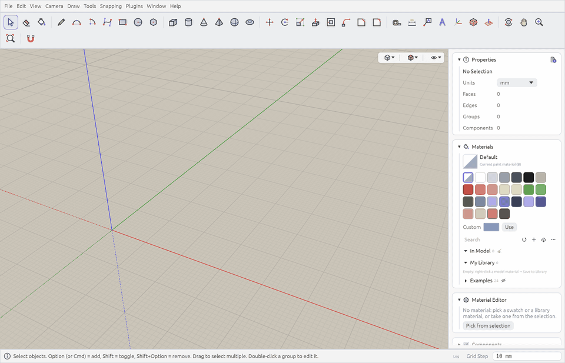
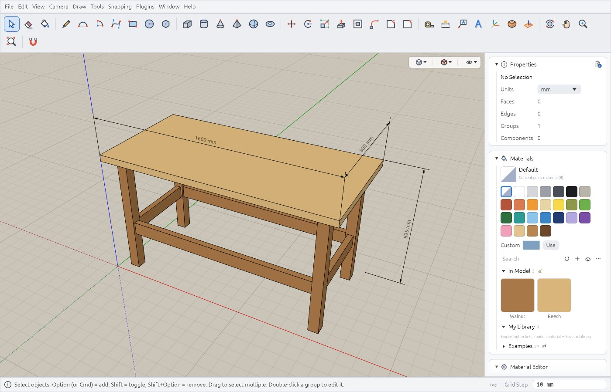
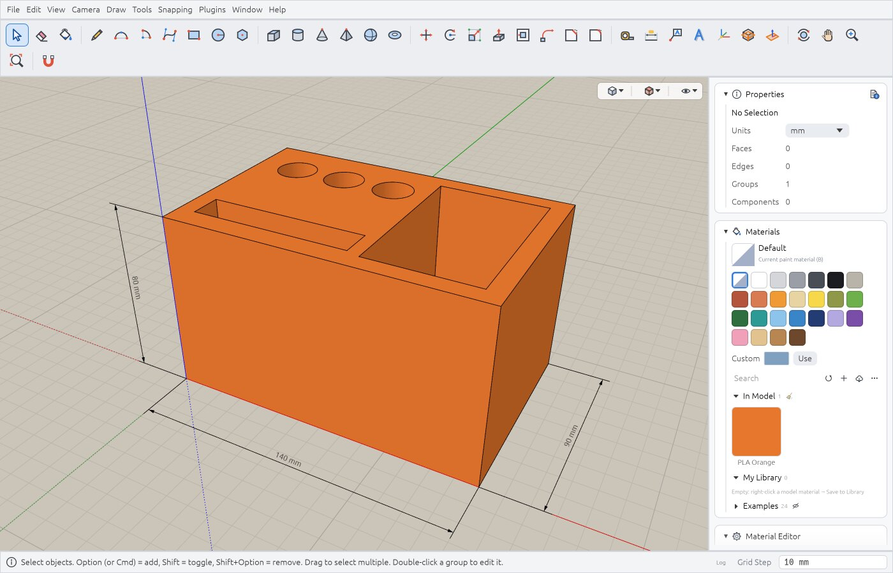
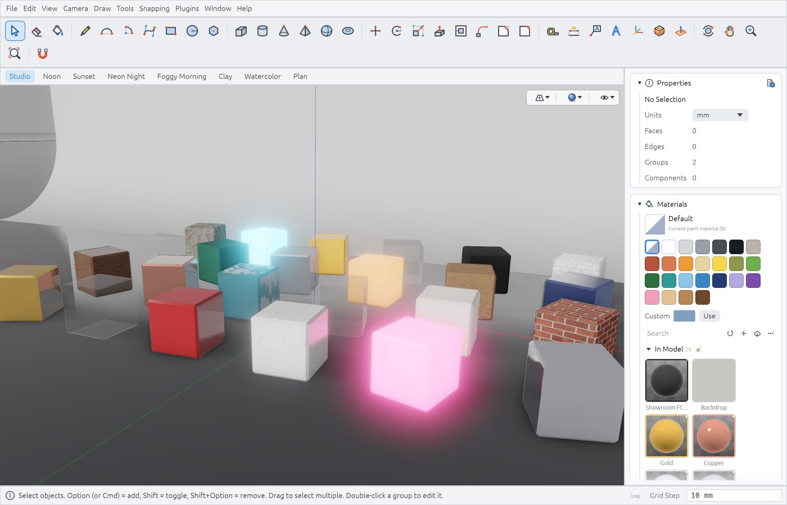
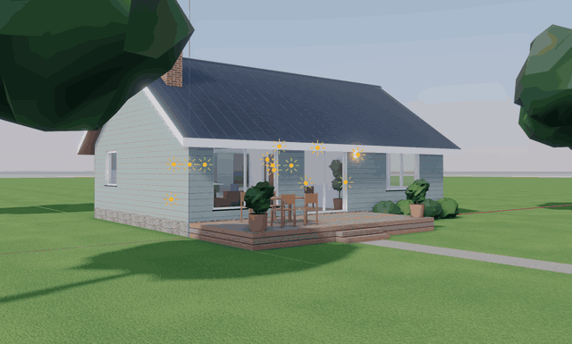

# Varstotas

A free, open-source 3D modeller for makers and hobbyists: plan furniture, workshop projects and
3D prints in real millimetres, then take the dimensions to the workshop or the model to a slicer.
Classic push/pull modelling, native on macOS, Windows and Linux. Written in Rust (egui + wgpu);
everything can be scripted.



## Features

- **Direct modelling** — lines, arcs, Bézier and freehand curves, Push/Pull, Offset, Sweep,
  chamfer and fillet, with inference snapping (endpoints, midpoints, axes, parallel /
  perpendicular) and typed exact values.
- **Making things** — dimensions on the model; preparing models for a slicer (checks and repair,
  wall-thickness maps, cutting with dowels, bed layout, STL / 3MF export); unfolding to SVG / PDF /
  DXF; sheets with scaled views; simple physics (drop objects, drape cloth).
- **Organising** — groups and reusable components, tags, outliner, scenes, section planes,
  dimensions and text, locks, several viewports.
- **Materials and rendering** — PBR materials with texture maps and a UV editor; a realistic
  real-time style with shadows, AO, reflections and bloom; a progressive GPU path tracer with
  denoising; custom WGSL shaders; animation export through scenes.
- **Libraries** — materials and components trays, online models and materials (Poly Haven,
  Smithsonian, NASA and more), parametric generators (shelves, stairs, railings…).
- **Scripting and automation** — Rhai console and scripts, plugins that add menu commands and
  importers, a Python client over a local bridge and an MCP server for AI agents.
- **Formats** — import glTF / GLB, OBJ, STL, PLY, FBX, DAE, 3MF, DXF; export glTF / GLB, OBJ,
  STL, PLY, DAE, 3MF, PNG.
- **Languages** — English, Russian, Lithuanian, Belarusian (Preferences → Interface → Language).

<p>
  
  
  
</p>

<p align="center">
  
</p>

## Download

Builds for macOS (`.dmg`, Apple Silicon and Intel), Windows (installer or portable `.zip`) and
Linux (AppImage, `.deb` or `.tar.gz`), the last two for x86_64 and Arm64, are on the [Releases](https://github.com/dirondin/varstotas/releases) page.

## Installing and running

**macOS** 11+ (Apple Silicon and Intel)

- `.dmg`: open it and drag Varstotas to Applications. Or with Homebrew:
  `brew install --cask dirondin/tap/varstotas`.
- The app is not notarized, so macOS blocks the first launch: open Varstotas once, then
  **System Settings → Privacy & Security → Open Anyway** (macOS 14 and earlier: right-click
  Varstotas → **Open** → **Open**). Or in Terminal:
  `xattr -dr com.apple.quarantine /Applications/Varstotas.app`.

**Windows** 10+ (x64) and Windows 11 on Arm

- `…-setup.exe`: the installer asks whether to install for you only or for everyone, and adds a
  Start menu entry and the `.vrst` file type. Remove it in Settings → Apps.
- `….zip`: portable; unzip anywhere and run `varstotas.exe`. Or with Scoop:
  `scoop bucket add dirondin https://github.com/dirondin/scoop-bucket` and then
  `scoop install dirondin/varstotas`.
- The builds are not signed, so SmartScreen may warn: **More info → Run anyway**.

**Linux** (x86_64 and aarch64, glibc 2.35+: Ubuntu 22.04, Debian 12, Fedora 36 or newer)

- `.AppImage`: `chmod +x Varstotas-*.AppImage` and run it. On the first start it offers to add
  itself to the applications menu (Preferences → General adds or removes it later). Without FUSE:
  `./Varstotas-*.AppImage --appimage-extract-and-run`.
- `.deb` (Debian, Ubuntu): `sudo apt install ./Varstotas-<version>-linux-<arch>.deb`, then run
  Varstotas from the menu or `varstotas` in a terminal. `sudo apt remove varstotas` removes it.
- `.tar.gz`: unpack and run `./varstotas` in place, or `./install.sh` to install into `~/.local`
  with a menu entry and the `.vrst` file type (`PREFIX=/usr/local sudo ./install.sh` for everyone,
  `./install.sh --uninstall` to remove).
- X11 and Wayland both work.

**Graphics.** Varstotas needs Vulkan, DirectX 12, Metal or OpenGL (ES) 3.0+. On the first start
it tries the graphics APIs one by one and keeps the first that works, so a machine without a
Vulkan driver falls back to OpenGL by itself. If the window stays black or the 3D view looks
wrong (some virtual machines), pick another one in **Preferences → General → Graphics API**; on
Linux, **OpenGL (llvmpipe)** draws in software, slower but correct.

## Data folder

Plugins, libraries, templates, your own translations, caches and the bridge for Python scripts
and AI agents live in one per-user folder: `~/Library/Application Support/Varstotas` on macOS,
`~/.local/share/varstotas` on Linux (`~/.var/app/io.github.dirondin.Varstotas/data/varstotas`
in the Flatpak), `%APPDATA%\Varstotas\data` on Windows. Preferences → General shows it.
Varstotas writes nowhere else unless you choose the place.

## Building from source

```bash
cargo run --release -p varstotas_app     # run
cargo test --workspace                   # tests
tests/ui/run_all.sh [name …]             # UI regression scripts (macOS; explicit repository fixtures)
scripts/readme-media.py                  # README animations and screenshots, the social preview (macOS, ffmpeg, ImageMagick)
```

## Documents
- [Vision and UX principles](docs/00-VISION.md)
- [Features → plan and statuses](docs/01-FEATURES.md)
- [Architecture](docs/02-ARCHITECTURE.md)
- [Code map](docs/CODEMAP.md)
- [Roadmap](docs/03-ROADMAP.md)
- [UX specification of the tools](docs/05-UX-SPEC.md)
- [Scripting (Rhai, Python, bridge)](docs/SCRIPTING.md) · [Generators](docs/GENERATORS.md) · [Plugins](docs/PLUGINS.md) · [Shaders](docs/SHADERS.md)
- [Localization](docs/LOCALIZATION.md)
- [Security model](SECURITY.md)
- [Native document format and metadata](docs/FILE-FORMAT.md)

## Structure
```
crates/varstotas_kernel  — geometry kernel (sticky geometry, push/pull, offset, sweep, IO)
crates/varstotas_render  — wgpu renderer, camera, path tracer
crates/varstotas_script  — Rhai scripting API over the kernel
crates/varstotas_i18n    — localization (Fluent)
crates/varstotas_app     — application: UI, tools, inference, Measurements box, plugins
locales/                 — UI texts, one .ftl file per language
python/                  — Python client of the local bridge and the MCP server
examples/                — example plugins, scripts, generators and the demo models (.vrst)
tests/ui/                — UI regression scripts, fixtures, models
vendor/                  — egui_code_editor with a local fix
```

## Examples
The [examples catalogue](examples/README.md) lists eight ready-to-open models, including furniture,
a pergola, a staircase and a workshop, with editable construction scripts for six of them.
Demo scenes, scripts, plugins and optional generators live only in `examples/` in this repository.
They are not embedded in the application or installed into `<data folder>`.
**Help → Examples** opens the repository examples in a browser. Download what you need:
open `.vrst` demos with File → Open, run scripts with File → Run Script, copy selected plugins
to `<data folder>/plugins/`, and generators to your components library.
Previously installed files are left untouched. Built-in Draw → Shapes tools use their own
resources in `crates/varstotas_app/assets/primitives/`.

## Document templates
File → New from Template lists the built-in unit presets and `.vrst` files from
`<data folder>/templates/`. Open Templates Folder opens that directory in Finder / Explorer.
Preferences → General → Templates folder lets you choose another directory or restore the default.
A file template creates an untitled, unsaved copy with its model settings; Save prompts for a new
file and never overwrites the template automatically. Files added to the directory appear the next
time the menu is opened. Existing unsaved work is protected by the usual Save / Don't Save / Cancel prompt.

## 3D printing preparation

**Window → Check Model…** opens the 3D printing preparation window with surface checks and conservative repair, intersection detection,
sampled wall-thickness heatmaps, overhang highlights, a persistent printer profile and bed
placement. Parts can be cut and capped, divided to fit a printer, and given sockets with
separate registration dowels. Scoped STL/3MF export preserves millimetres and separate 3MF
objects, with a handoff to the slicer set as the default app for `.3mf` / `.stl`. Mutations are undoable and retain
original scale. See [printing tools and limitations](docs/3D-PRINTING.md).

## Mesh inspection and imported assets

View → Triangles is an independent checkbox available over every display style, including
X-Ray. It shows the actual tessellation, polygon diagonals and soft edges. Each viewport and
saved scene keeps its own choice. Ordinary X-Ray suppresses internal shallow/coplanar edges
while keeping boundaries and strong creases.

Mesh import shares surface construction across glTF/GLB, OBJ, STL, PLY, FBX, DAE, 3MF and
DXF faces, preserving thin layers and overlapping polygons. Authored normals are retained
where the format supplies them; textured imports retain atlas UV shear. Legacy Blender
Lambert/Blinn sets incorrectly exported entirely as index-matched glass receive narrowly
scoped material recovery. Transform and paste previews show the complete selected mesh;
only library thumbnails use sampled edges. Previously imported
native assets need reimporting from their original files to recover information discarded
by older builds. Texture Position and Reverse Faces preserve the full affine placement.

Formats with files beside the model (OBJ with its `.mtl` and textures, DAE and FBX textures,
glTF with a `.bin`): export asks for the file name and writes those files next to it; where the
app may write only the picked file (a sandbox) it also asks for their folder. An import that cannot read them offers to choose the model's folder and imports again from
there. A sandboxed app (the Flatpak) is given only what the dialog picked, a file or a folder.

## Tutorial and navigation

**Tutorial** is available on the start screen and in Help. Its ten-step wizard combines a
small modelling project, concrete exercises, tool activation buttons and links to detailed
help. It can stay open beside the model; Back/Next/Start over control the walkthrough.

Preferences → Navigation separates mouse-wheel settings from smooth two-finger swipes,
pinch zoom and two-finger twist. Configure sensitivity, inversion, orbit/pan/zoom for swipes,
and orbit around vertical / roll / off for twist. Native gesture availability depends on the
OS/driver. Smooth-scroll pointing devices use the same swipe settings.

Online model/material catalogues, asset downloads and previews show received bytes and a
percentage/total when Content-Length is available. Unknown totals show bytes received. Rhai
network helpers participate automatically; downloads inside external Python plugins and a
browser cannot provide byte progress unless they report it to the app.

## Document metadata

Window → Document Info is resizable, with Info (statistics), Meta (text, license and preview)
and Cleanup (unused resources) tabs. Meta offers multiline text/description and license fields
(name, URL or full text). Apply makes one undoable change; save the document to persist it. Native documents now
write format version 4 (authored corner normals and full affine UV placement) and continue
reading versions 1–3 with defaults for missing fields. Unsupported
versions are rejected. Material files retain their independent version 1.
See [format and compatibility](docs/FILE-FORMAT.md).

## Startup, feedback and previous saves

The start screen offers a new model with a unit preset, Open, recent documents, Examples and a
quick guide. **Show at startup** is shared with Preferences → Interface; File → Start Screen
opens it at any time. Opening a document from the command line skips the start screen:

```sh
target/debug/varstotas "/path/to/my model.vrst"
target/debug/varstotas --open "/path/to/my model.vrst"
open -n target/Varstotas.app --args "/path/to/my model.vrst"  # macOS bundle
```

`--help` and `--version` work without initializing the graphical application. File associations
are not registered yet.

The graphics API is chosen at start: on Windows and Linux each of Vulkan, DirectX 12 (Windows)
and OpenGL is tried in a separate process, a graphics card before a software renderer, and the
first that works is kept in `<data folder>/gpu.json` until the next version. An API whose start
never drew a frame is skipped from then on. **Preferences → General → Graphics API** picks one by
hand and restarts with the document as it is; on Linux it also offers OpenGL drawn in software
(llvmpipe, `LIBGL_ALWAYS_SOFTWARE`), slow but right where a virtual GPU draws wrong (virgl in UTM). The `WGPU_BACKEND` environment variable (`vulkan`,
`dx12`, `metal`, `gl`) overrides both.

**Help → Report a Problem** previews the message with version, platform and GPU details.
The latest warnings/errors are optional. Copy the report or open a prefilled GitHub issue in
your browser; sign in and submit it yourself. Private repositories require access. The app
stores no GitHub token and does not attach the model or screenshots automatically.

Explicit document saves, including bridge saves, keep one previous version in the data folder:
`model.vrst` → `<data folder>/backups/model (<hash>).bak.vrst`, the hash telling apart same-named
documents in different folders. **Preferences → General → Keep a backup of the previous saved version**
is enabled by default; disabling it leaves existing backups untouched. Open the backup with File → Open to recover it, then Save As
to the desired filename. Saving an unchanged model preserves the last distinct backup.
If the backup cannot be written, the existing document is left intact
and saving reports an error. Autosaves go to `<data folder>/autosave` and do not rotate this backup.
Nothing is written next to a document: in a sandbox (Flatpak) the app sees only the file chosen in
the dialog, not its folder.

## Release builds
Artifacts go to `dist/` (not tracked by git).

```bash
scripts/build-macos.sh      # macOS universal (arm64 + x86_64): .dmg + .zip
scripts/build-macos.sh --debug  # local target/Varstotas.app (correct Dock name and icon)
scripts/build-windows.sh    # Windows x86_64 portable .zip, cross-built from macOS
scripts/build-windows.sh --native [--arch aarch64]  # on Windows (MSVC, Git Bash): .zip + installer
scripts/build-linux.sh      # Linux (this machine's arch): .tar.gz + .AppImage + .deb
```

- **macOS** — `scripts/build-macos.sh [--no-dmg]`: installs the `x86_64-apple-darwin` target if needed, builds release for both architectures, joins them with `lipo`, assembles `dist/Varstotas.app` (Info.plist: `dev.varstotas.app`, macOS ≥ 11, Retina), builds the icon (`crates/varstotas_app/assets/icon.png`, drawn by `scripts/make_icon.py` → `iconutil` → `.icns`), signs ad-hoc (`codesign -s -`) and packs `Varstotas-<version>-macos-universal.zip` and `.dmg` (with an Applications link). There is no Developer ID signature or notarization — on first launch: System Settings → Privacy & Security → "Open Anyway" (macOS 14 and earlier: right click → "Open").
- **Windows** — `varstotas.exe` is a GUI-subsystem binary with the icon and version resource embedded (`crates/varstotas_app/build.rs`, `winresource`); Windows 10+, no external DLLs. `Varstotas-<version>-windows-<arch>.zip` is the portable build. With `--native` (MSVC on Windows) the script also builds `Varstotas-<version>-windows-<arch>-setup.exe` with Inno Setup 6 (`packaging/windows/varstotas.iss`; installed with Chocolatey when missing): per-user or all-users install, Start menu entry, optional desktop icon, the `.vrst` file association, uninstaller; English and Russian wizard. Without `--native` it cross-compiles with mingw-w64 (installed via brew) and makes the zip only. `--arch aarch64` (native only) builds for Windows on Arm; the installer then allows Arm64 only, while the x86_64 one also installs there under emulation.
- **Linux** — `scripts/build-linux.sh [--no-appimage] [--no-deb]`: needs `pkg-config`, `libwayland-dev`, `libxkbcommon-dev` and, for the `.deb`, `dpkg-dev`. `Varstotas-<version>-linux-<arch>.tar.gz` holds the binary, icons, `varstotas.desktop`, the `.vrst` file type (`packaging/linux`) and `install.sh` (into `~/.local`, `--uninstall`; `PREFIX=/usr/local` for everyone). `Varstotas-<version>-linux-<arch>.AppImage` is one runnable file, made with `appimagetool` (downloaded into `target/tools`). `Varstotas-<version>-linux-<arch>.deb` installs the same files under `/usr` (package `varstotas`; its library dependencies come from `dpkg-shlibdeps`, the ones loaded at run time are listed in the script); the release build installs it on the runner and runs `varstotas --version`. X11 and Wayland both work (loaded at run time); release builds are made on Ubuntu 22.04 (glibc 2.35).
- `VARSTOTAS_VERSION` overrides the version from Cargo in every script.
- Checking the build without a UI click: `VARSTOTAS_SCREENSHOT=shot.bmp dist/Varstotas.app/Contents/MacOS/varstotas` — captures the window and exits.

## CI and releases
GitHub Actions in `.github/workflows`:

- **CI** (`ci.yml`) — every pull request and push to `master`: `cargo clippy -D warnings` and `cargo test --workspace` on Linux, and the tests on Windows and macOS.
- **Release build** (`release.yml`) — pushing a tag `release-<version>`: the version check, unit tests in the release profile, release builds on macOS (universal) and on Windows and Linux for x86_64 and Arm64 (GitHub's Arm runners). All the packages above and `SHA256SUMS.txt` are kept as the run's `release-files` artifact; nothing is published. To build a tag again, run the workflow by hand from the tag (Actions → Release build → Run workflow → Use workflow from → Tags).
- **Publish release** (`publish.yml`) — by hand only, run from the tag the same way. It needs a successful Release build of the tag at its current commit and a successful CI run of that commit, takes that build's files as they are (no rebuild), checks the checksums, attaches everything to a draft and then publishes it as "Varstotas <version>". Its notes are a downloads table (`.github/release-notes.md`) followed by the changes since the previous release. A version with a `-` (`release-0.2.0-rc.1`) makes a pre-release. A release that is already published is never changed; with release immutability on (Settings → General → Releases) its files and tag are frozen.
- **Package managers** (`packages.yml`) — after publishing (or by hand with a published tag): a pull request to winget-pkgs, the Homebrew tap and Scoop bucket updated, and AUR `varstotas-bin` pushed (dormant until an AUR key is configured). Templates are in `packaging/` (`scripts/package-manifests.py`); each step runs only when its token is configured.

Every CI build is stamped with the run number and commit: `varstotas --version`, About and Report a Problem show `0.1.0 (build 42, 4cc73e5)` (Windows file version `0.1.0.42`, macOS `CFBundleVersion` `42`). Local builds show `dev` instead of a number; `VARSTOTAS_BUILD=<n>` sets one by hand.

The tag must match the workspace version in `Cargo.toml` (the build fails at once otherwise), so a release is: bump `version` under `[workspace.package]`, build once (updates `Cargo.lock`), commit, then

```bash
git tag release-0.1.0 && git push origin master release-0.1.0
# once CI and Release build have passed:
gh workflow run publish.yml --ref release-0.1.0
```

Until it is published, a failed build can be fixed by moving the tag to a new commit (`git tag -f`, `git push -f origin <tag>`).
